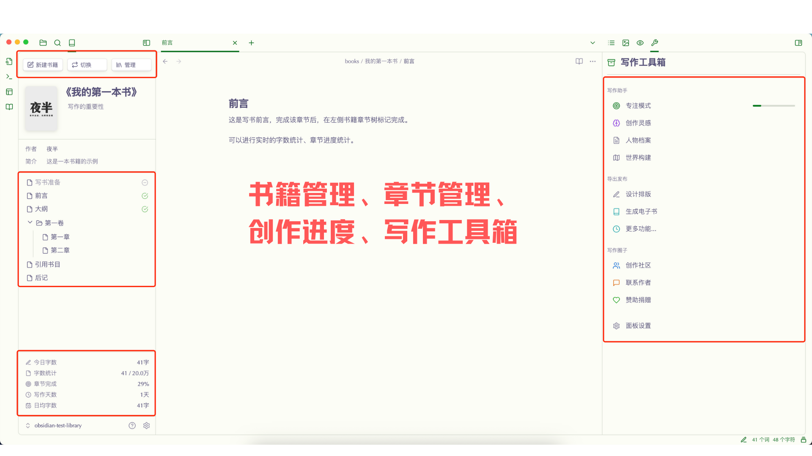
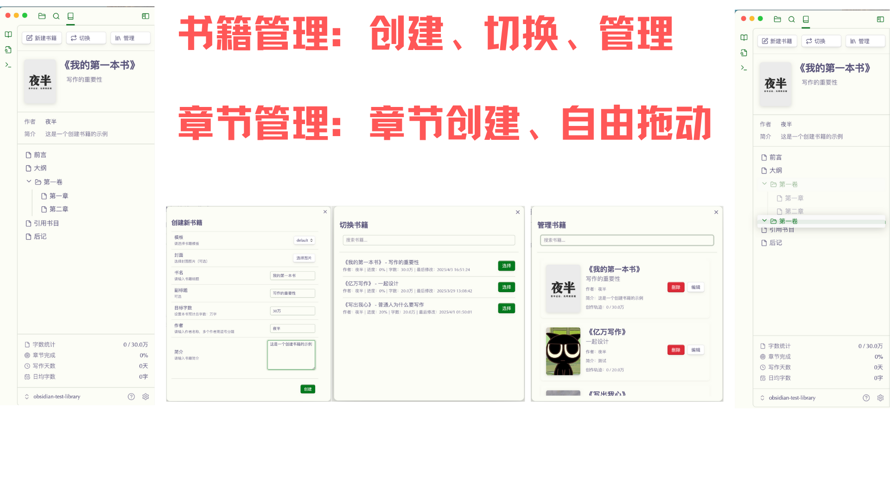
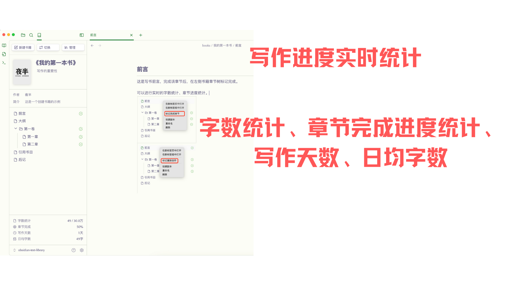
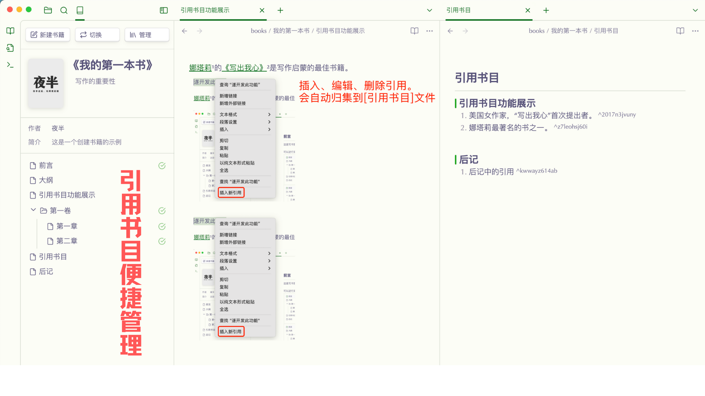

# Book Smith

Book Smith 是一个专为 Obsidian 设计的写作管理插件。它能帮助作者更好地组织和管理他们的写作项目。

   

简体中文 | [English](README.en.md)
## 功能演示
<!-- 插图展示 -->

  
  
  
  

## 功能特点

- 📚 书籍项目管理
  - 创建和管理多个书籍项目
  - 支持自定义各种类型的书籍模板
  - 自定义封面
  - 基础信息管理
- 📑 章节管理
  - 树形结构展示
  - 拖拽排序功能
  - 章节状态标记
  - 灵活的文件夹组织
- 📊 写作统计
  - 实时字数统计
  - 写作进度追踪
  - 按本地日期累计正文保存时的正向字数增量，删除文字不扣减当天写作量
  - 目标完成度分析
- 🎯 专注写作
  - 番茄工作法
  - 可自定义工作/休息时长
  - 写作数据追踪
  - 中断统计与分析
- 📝 引用管理
  - 快速创建引用
  - 自动编号系统
  - 参考文献生成
  - 引用检索功能
- 📤 导出功能：支持桌面端 PDF 排版与导出，可设置封面、页眉页脚和目录

## 使用方法

### 基础使用
1. 安装插件后，在左侧边栏会出现书籍管理图标
2. 点击 "新建书籍" 创建你的第一本书
3. 在书籍管理界面可以：
   - 创建/编辑章节
   - 管理书籍信息
   - 查看写作统计
### 引用管理
1. 选中文本创建新引用
2. 使用右键菜单管理引用
3. 自动生成参考文献
4. 快速检索已有引用
### 专注写作
1. 点击专注模式图标进入专注写作
2. 设置工作时长和休息时间
3. 开始专注写作
4. 查看写作数据和进度

## 安装方法

### 从 Obsidian 社区插件安装（推荐）
1. 打开 Obsidian 设置
2. 转到第三方插件设置
3. 关闭安全模式
4. 点击浏览社区插件
5. 搜索 "Book Smith"
6. 点击安装并启用插件

### 手动安装
1. 下载最新版本的release文件:https://github.com/Yeban8090/book-smith/releases
2. 解压后将文件夹复制到 Obsidian 插件目录：`{vault}/.obsidian/plugins/`
3. 重启 Obsidian
4. 在设置中启用插件

## 配置说明

### 基础设置
- 默认作者信息配置
- 书籍存储路径设置

### 模板设置
- 默认模板选择：设置创建新书籍时使用的默认模板
- 模板管理：查看和编辑现有模板
- 自定义模板：创建适合不同写作需求的模板
- 模板结构：自定义章节结构
- 模板描述：为每个模板添加说明文档

### 专注模式设置
- 工作时长调整
- 休息时间设置
- 提醒方式选择
- 统计规则配置

## 使用技巧
- 使用模板功能快速创建常用的书籍结构
- 定期备份你的书籍数据
- 利用统计功能设定每日写作目标
- 使用引用功能管理你的研究资料
- 使用 PDF 导出前预览排版，调整封面、页眉页脚和目录
- 善用拖拽功能组织章节结构
- 合理使用章节状态标记追踪进度
- 通过专注模式提高写作效率

## 平台支持
- 需要 Obsidian 1.4.10 或更高版本，书籍管理和写作功能允许在桌面端及 iPad 等移动端使用
- PDF 预览和导出依赖 Electron，仅在桌面端显示入口；移动端实际体验仍需设备验证
- 设置中的书籍路径建议支持独立设置窗口
- PDF 目录页码按实际打印结果计算，与正文页眉页脚一致，包含目录页、不包含单独插入的封面；资源加载失败、章节缺失或预览过期时会提示重新处理
- 客户端未提供完整目录跳转目标时，保留目录链接并省略目录页码，不中断整本书导出；正文页脚页码仍正常输出
- 书籍与章节文件保存在 Obsidian 仓库中，跨设备同步由用户的仓库同步方案负责
- 统计在新建、复制、删除、排除或恢复章节后自动重算；这些操作不计为当天写作量
- 相同字数的重写不计入新增量，历史版本的日期和净增记录保留，不自动迁移

## 支持的语言
插件界面目前支持：
- 简体中文
- 英文

## 支持作者
如果这个插件对你有所帮助，可以考虑请作者喝杯咖啡 ☕：

  

    

      <strong>微信支付</strong> 
      
    

    

      <strong>支付宝</strong> 
      
    

    

      <strong>Buy Me a Coffee</strong> 
      
    

  

您的支持是我持续改进这个插件的动力！

## 许可证
MIT License。查看 [LICENSE](LICENSE) 获取更多信息。

## 作者
Yeban

## 反馈与支持
如果你遇到任何问题或有建议，欢迎在 GitHub 上提交 issue。
